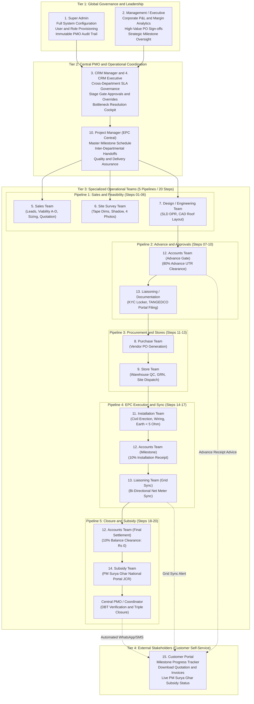

# NIRT Solar CRM & Project Management System
## Comprehensive System Specification & Client Handover Documentation

**Prepared for:** Management & Executive Leadership  
**Client Organization:** NIRT Renewable Energy Private Limited  
**Corporate Identity:** CIN `U74999TZ2017PTC028477` | Salem, Tamil Nadu  
**Empanelment:** MNRE Empanelled EPC Vendor (PM Surya Ghar: Muft Bijli Yojana)  
**System Designation:** End-to-End Solar Project Lifecycle & Project Governance Platform  
**Document Classification:** Confidential & Client-Ready Technical Specification  
**Version:** 1.0 (Production Architecture Baseline)

---

## Master Operational Pipeline & Step-by-Step Process Flow (At a Glance)

> **Direct Operational Sequence (No Fluff / Direct Action):** The end-to-end solar EPC project journey mapped across 5 operational pipelines and 20 sequential process steps from initial customer inquiry to final DBT subsidy credit and triple project closure.

```
[1. Lead] ➔ [2. Qualify (A-C/D)] ➔ [3. Survey] ➔ [4. Design] ➔ [5. Quote] ➔ [6. Order] ➔ [7. 80% Advance] ➔ [8. DISCOM] ➔ [9. Procure] ➔ [10. Delivery] ➔ [11. Install] ➔ [12. 10% On Installation] ➔ [13. Net Meter] ➔ [14. 10% Final] ➔ [15. Subsidy DBT]
```

> [!IMPORTANT]
> **Data Integrity & "Edit with Reason" Correction Protocol:**  
> - **Zero Delete Policy:** System records, milestones, uploads, and stages can never be deleted by any user or administrator.  
> - **Edit Option with Mandatory Reason:** If a staff member enters incorrect input at any stage (e.g. typo in EB Consumer Number, incorrect sanctioned load, or wrong survey dimension), an **Edit** option is provided across all 20 steps.  
> - **Audit Trail Accountability:** Modifying any field requires entering a mandatory **Reason for Edit**. The system forensically records the previous value, new value, reason, actor, and timestamp directly into the immutable **PMO Audit Log**.

### Complete End-to-End Pipeline & Process Steps Matrix

| Pipeline / Phase | Step # | Process Step | Responsible Role | Action: Data Inputs & File Uploads | Mandatory Milestone Gate & Edit Rule |
| :--- | :---: | :--- | :--- | :--- | :--- |
| **1. Sales & Feasibility** | **01** | Lead Inward & Intake | Sales Executive | **Input:** Name, Phone, Address, Circle, EB Consumer #<br/>**Upload:** None (Optional visiting card / inquiry doc) | **Gate:** Deduplicated Lead Profile Created<br/>**Edit:** Edit with Reason (Logged to PMO Audit) |
| **1. Sales & Feasibility** | **02** | Lead Qualification (Viability) | Sales Executive | **Input:** Sanctioned Load, Monthly Units, Roof Type, Status<br/>**Outcome:** **Qualified** (Cat A/B/C) OR **Unqualified** (Cat D Dropped) | **Gate:** Viability Dossier / Disqualification Reason Logged<br/>**Edit:** Edit with Reason (Logged to PMO Audit) |
| **1. Sales & Feasibility** | **03** | Site Survey & Feasibility Audit | Site Surveyor / Engineer | **Input:** Terrace length x width, Shadow analysis, Cable meters<br/>**Upload:** 4 Mandatory Photos (Roof, EB Meter, DB, Inverter Wall) | **Gate:** Complete Survey Dossier Approved<br/>**Edit:** Edit with Reason (Logged to PMO Audit) |
| **1. Sales & Feasibility** | **04** | System Design & Engineering DPR | Design / Technical Engineer | **Input:** System kW sizing, Inverter model, String configuration<br/>**Upload:** Single Line Diagram (SLD) & Roof CAD Layout | **Gate:** Verified Electrical SLD & System DPR<br/>**Edit:** Edit with Reason (Logged to PMO Audit) |
| **1. Sales & Feasibility** | **05** | Commercial Quotation Sizing | Sales Executive | **Input:** Equipment BOM pricing, Authorized Discount, Terms<br/>**Upload:** None (System auto-compiles official PDF proposal) | **Gate:** Formal Quotation Dispatched to Client<br/>**Edit:** Edit with Reason (Logged to PMO Audit) |
| **1. Sales & Feasibility** | **06** | Customer Order Confirmation | Sales / Customer | **Input:** Chosen payment mode, Delivery target date<br/>**Upload:** Signed Customer Work Order copy | **Gate:** Unified Project ID Generated (`NIRT-YYMM-XXXX`)<br/>**Edit:** Edit with Reason (Logged to PMO Audit) |
| **2. Advance & Approvals** | **07** | 80% Advance Receipt Gatekeeper | Accounts Executive | **Input:** Bank Transaction UTR, Amount (Rs.), Date, Mode<br/>**Upload:** Bank deposit slip / credit confirmation advice | **Gate:** Stage 7 Advance Cleared (Hard Lock Released)<br/>**Edit:** Edit with Reason (Logged to PMO Audit) |
| **2. Advance & Approvals** | **08** | Document Locker KYC Assembly | Liaison Officer | **Input:** Aadhaar Number, EB Consumer Number, Property Tax ID<br/>**Upload:** Aadhaar Card, EB Bill, Cancelled Cheque, Property Tax | **Gate:** Complete Document Locker Dossier Assembled<br/>**Edit:** Edit with Reason (Logged to PMO Audit) |
| **2. Advance & Approvals** | **09** | TANGEDCO DISCOM Portal Filing | Liaison Officer | **Input:** DISCOM Application Number, Date of Online Filing<br/>**Upload:** TANGEDCO Online Submission Acknowledgment | **Gate:** DISCOM Portal Application Verified<br/>**Edit:** Edit with Reason (Logged to PMO Audit) |
| **2. Advance & Approvals** | **10** | Technical Feasibility Sanction | Liaison / TANGEDCO | **Input:** Sanction Letter Reference Number, Approved kW Capacity<br/>**Upload:** Official TANGEDCO Technical Feasibility Sanction | **Gate:** Grid Interconnection Feasibility Sanctioned<br/>**Edit:** Edit with Reason (Logged to PMO Audit) |
| **3. Procurement & Store** | **11** | Vendor PO Issuance | Procurement Executive | **Input:** PO Number, Supplier Name, Module & Inverter Specifications<br/>**Upload:** Official Vendor Purchase Order (PO) PDF | **Gate:** Factory PO Dispatched to Tier-1 Suppliers<br/>**Edit:** Edit with Reason (Logged to PMO Audit) |
| **3. Procurement & Store** | **12** | Warehouse QC & Inwarding (GRN) | Store Executive | **Input:** Goods Receipt Note (GRN) #, Inward Date, Serial Numbers<br/>**Upload:** Warehouse QC Inspection Sign-off & Delivery Challan | **Gate:** Physical GRN Inward Tagged to Project ID<br/>**Edit:** Edit with Reason (Logged to PMO Audit) |
| **3. Procurement & Store** | **13** | Material Dispatch to Site | Store / Logistics | **Input:** Dispatch Vehicle Number, Driver Contact, E-Way Bill Number<br/>**Upload:** Stamped Site Material Delivery Challan | **Gate:** Complete BOM Delivered to Customer Site<br/>**Edit:** Edit with Reason (Logged to PMO Audit) |
| **4. EPC Site Execution** | **14** | Civil Structure & Module Mounting | EPC Site Engineer | **Input:** Structure Torque Check (Nm), Tilt Angle, Alignment Check<br/>**Upload:** 4 Milestone Erection Photos (Legs, Purlins, Panels) | **Gate:** Mechanical Structure Erection Signed Off<br/>**Edit:** Edit with Reason (Logged to PMO Audit) |
| **4. EPC Site Execution** | **15** | Electrical Cabling & Inverter Setup| EPC Site Engineer | **Input:** Earth Resistance (< 5 Ω), String VOC/ISC, Polarity Check<br/>**Upload:** Inverter LCD Display Photo & Soil Earth Test Certificate | **Gate:** Complete Electrical Commissioning Signed Off<br/>**Edit:** Edit with Reason (Logged to PMO Audit) |
| **4. EPC Site Execution** | **16** | 10% Installation Balance Receipt | Accounts Executive | **Input:** Bank UTR Reference, Amount (Rs.), Receipt Number<br/>**Upload:** Bank Credit Counterfoil / Receipt Advice | **Gate:** 90% Cumulative Milestone Funds Reconciled<br/>**Edit:** Edit with Reason (Logged to PMO Audit) |
| **4. EPC Site Execution** | **17** | TANGEDCO Net Metering & Sync | Liaison / DISCOM | **Input:** Bi-Directional Net Meter Number, Grid Sync Date & Time<br/>**Upload:** TANGEDCO Joint Commissioning & Metering Report | **Gate:** Solar PV Generating Power Synchronized to Grid<br/>**Edit:** Edit with Reason (Logged to PMO Audit) |
| **5. Closure & Subsidy** | **18** | 10% Final Balance Collection | Accounts Executive | **Input:** Final Settlement Bank UTR, Receipt Number, Balance = Rs. 0<br/>**Upload:** Final Commercial Tax Invoice & Zero Balance Voucher | **Gate:** Commercial Closure Achieved (Balance = Rs. 0.00)<br/>**Edit:** Edit with Reason (Logged to PMO Audit) |
| **5. Closure & Subsidy** | **19** | PM Surya Ghar Subsidy Submission | Subsidy Desk | **Input:** National Portal Claim Reference Number, Beneficiary Bank IFSC<br/>**Upload:** Uploaded Work Completion Report & Installed Net Meter Photo | **Gate:** PM Surya Ghar National Portal Subsidy Claim Lodged<br/>**Edit:** Edit with Reason (Logged to PMO Audit) |
| **5. Closure & Subsidy** | **20** | DBT Subsidy Credit & Formal Closure| Project Coordinator (PMO) | **Input:** Direct Benefit Transfer (DBT) Bank UTR, Disbursed Amount<br/>**Upload:** Customer Bank DBT Credit Advice / Passbook Entry | **Gate:** Formal Triple Closure (Technical + Commercial + Subsidy)<br/>**Edit:** Edit with Reason (Logged to PMO Audit) |

---

## 1. Executive Summary & Business Vision

### 1.1 The Business Need
Solar photovoltaic engineering, procurement, and construction (EPC) is an operationally intensive business. A single commercial or residential solar installation involves up to **20 sequential process steps across 5 operational pipelines**, intersects **8 specialized departments**, requires liaison with external government entities (**TANGEDCO** and the **PM Surya Ghar National Portal**), and demands stringent documentation across physical site surveys, electrical safety audits, civil structure installations, and banking/DBT subsidy workflows.

Generic customer relationship management tools (such as basic sales CRMs or contact trackers) fail because they treat solar as a simple sales transaction. In solar EPC, **the sale is merely the starting line**. The real risks of margin erosion, customer dissatisfaction, and regulatory stalls occur post-sale: during DISCOM net-metering approvals, material staging, physical installation, and subsidy release.

### 1.2 Core Architectural Principle
The NIRT Solar CRM is architected not as a passive lead database, but as an **Active Project Management & Governance System** governed by five foundational rules:
1. **One Customer – One Master Record:** A unified identity eliminating duplicated customer profiles across marketing, sales, and accounts.
2. **One Project – One Digital Folder:** Every contract, photo, SLD drawing, bill, and test certificate is bound permanently to a unified **Project ID** (`NIRT-YYMM-XXXX`).
3. **Clear Ownership & Deadlines:** Every single task across all 20 steps has a named responsible owner, department, planned SLA date, and escalation trigger.
4. **Hard Stage Gates:** Commercial and procurement actions cannot proceed without prerequisite sign-offs (e.g., procurement is hard-locked until Accounts logs the Stage 7 Advance receipt).
5. **The 3 Mandatory Closures:** A project cannot be marked completed until it achieves **Technical Closure** (commissioning report + net meter sync), **Commercial Closure** (balance = Rs. 0), and **Subsidy Closure** (DBT bank credit confirmed via UTR).

---

## 2. End-to-End 20-Step Project Lifecycle across 5 Operational Pipelines

The NIRT system digitizes the entire journey from initial lead capture to post-commissioning subsidy release across 5 unified operational pipelines:

```mermaid
flowchart TD
    subgraph Phase1 ["Pipeline 1: Sales & Feasibility (Steps 01 to 06)"]
        S1["Step 01: Lead Intake
(Omnichannel Deduplication)"] --> S2["Step 02: Lead Qualification
(Qualified A/B/C vs Dropped D)"]
        S2 -->|Unqualified| S2_DROP["Disqualified Archive
(Weak Roof / Low Load / Disputed Title / Reason Logged)"]
        S2 -->|Qualified| S3["Step 03: Site Survey & Feasibility
(Tape Dims + Shadow + 4 Mandatory Photos)"]
        S3 -->|Rejected| S3_REJ["Feasibility Rejected
(Structural Issue / Heavy Shadow)"]
        S3 -->|Approved| S4["Step 04: System Design & DPR
(Single Line Diagram + Roof CAD)"]
        S4 --> S5["Step 05: Commercial Quotation
(BOM Sizing + 80/10/10 Payment Terms)"]
        S5 --> S6["Step 06: Customer Order
(Signed Work Order + Project ID Generated)"]
    end

    subgraph Phase2 ["Pipeline 2: Advance & Approvals (Steps 07 to 10)"]
        S6 --> S7{"Step 07: 80% Advance Gatekeeper
(Accounts Bank UTR Clearance)"}
        S7 -->|Advance Confirmed| S8["Step 08: Document Locker
(KYC, Aadhaar, EB Bill, Cheque)"]
        S8 --> S9["Step 09: DISCOM Portal Application
(TANGEDCO Form 1 Online Submission)"]
        S9 --> S10["Step 10: Technical Feasibility Sanction
(Transformer Load & Grid Feasibility Approval)"]
    end

    subgraph Phase3 ["Pipeline 3: Procurement & Stores (Steps 11 to 13)"]
        S10 --> S11["Step 11: Vendor PO Issuance
(Tier-1 TopCon Modules & Inverters)"]
        S11 --> S12["Step 12: Warehouse QC & GRN
(Serial Numbers Tagged to Project ID)"]
        S12 --> S13["Step 13: Material Site Dispatch
(Delivery Vehicle + Stamped Delivery Challan)"]
    end

    subgraph Phase4 ["Pipeline 4: EPC Site Execution & Testing (Steps 14 to 17)"]
        S13 --> S14["Step 14: Civil Structure & Modules
(GI Rails Anchored + Modules Torqued)"]
        S14 --> S15["Step 15: Electrical Cabling & Inverter
(AC/DC Wiring + Earthing Tested < 5 Ω)"]
        S15 --> S16{"Step 16: 10% On Installation
(Accounts Receipt Milestone Confirmed)"}
        S16 --> S17["Step 17: TANGEDCO Net Metering & Sync
(Bi-Directional Meter Connected & Live)"]
    end

    subgraph Phase5 ["Pipeline 5: Final Settlement, Subsidy & Closure (Steps 18 to 20)"]
        S17 --> S18{"Step 18: 10% Final Balance Collection
(Customer Outstanding = Rs. 0.00)"}
        S18 --> S19["Step 19: PM Surya Ghar Subsidy Claim
(JCR Upload + National Portal Claim)"]
        S19 --> S20["Step 20: DBT Subsidy Credit & Triple Closure
(Bank UTR Verified → Formal Project Closure)"]
    end
```



---

## 3. Departmental Responsibility Matrix & Project Coordination (PMO)

Operational accountability is structured across **8 functional departments** and coordinated by a centralized **Project Coordinator (Central PMO)**, directly mapped to the **20 Steps from Page 1**:

| Department | Operational Scope | Owned Steps (Page 1) | Key Deliverable / Governance Output |
| :--- | :--- | :---: | :--- |
| **Sales** | Omnichannel lead intake, viability check (A/B/C/D), quotation sizing, work order confirmation. | Steps 01, 02, 05, 06 | Qualified Lead profile, Signed Quotation, Customer Work Order. |
| **Engineering & Survey** | Field feasibility, shadow analysis, electrical DB checks, DPR, and SLD generation. | Steps 03, 04 | 4-Point Photo Survey Dossier, Roof Layout, Single Line Diagram (SLD). |
| **Accounts** | Financial gating, milestone receipts (80% Advance, 10% Installation, 10% Final Settlement). | Steps 07, 16, 18 | Advance Clearance Certificate, Final Invoice, Balance Zero Receipt. |
| **Liaison & Documentation** | DISCOM (TANGEDCO) approvals, consumer portal filings, statutory coordination, net meter sync. | Steps 08, 09, 10, 17 | TANGEDCO Application No, Feasibility Sanction, Net Meter Test Report. |
| **Purchase & Stores** | Vendor PO generation, material inwarding, QC verification, GRN allocation, site dispatch. | Steps 11, 12, 13 | Purchase Orders, Inward GRN tagged to Project ID, Material Dispatch Slip. |
| **EPC / Site Projects** | Civil erection, electrical wiring, inverter placement, safety compliance, earthing < 5 Ω. | Steps 14, 15 | Structural Torque Check, Inverter Commissioning, Earthing Test Report. |
| **Subsidy Desk** | National Portal claim processing, documentation verification, DBT tracking. | Steps 19, 20 | National Portal Claim Ref, Subsidy Sanction Letter, Bank UTR Match. |
| **Management / Super Admin**| Strategy, margin discount authorizations, MIS analytics, team governance. | All Steps (01 to 20) | System Configuration, Discount Approvals ($>10\%$), Audit Log Reviews. |
| **Project Coordinator** | **Central PMO**: End-to-end milestone monitoring, preventing cross-department handoff stalls. | Steps 01–20 SLA Governance | Planned vs. Actual SLA compliance, cross-department bottleneck resolution. |

---

## 4. Ground Operations Reality vs. Software System Role
To ensure total operational clarity between site technicians and software users, the system explicitly distinguishes between physical site realities and digital CRM functions:

| Activity / Requirement | Ground Reality on Site (Domestic Homes) | Role of the NIRT Solar CRM |
| :--- | :--- | :--- |
| **Physical Site Geometry** | Property owners do not possess blueprints. Surveyors measure terrace dimensions using a measuring tape/laser meter and sketch obstacles on a clipboard. | Captures tape measurements (length x width), shadow obstacles, and 4 high-res photos (Roof, EB Meter, DB Panel, Inverter Wall). |
| **TANGEDCO SLD Drawing** | Standard pre-approved electrical single line diagrams for 1 kW, 3 kW, 5 kW, 10 kW indicating Inverter -> Net Meter -> Grid connection. | Provides digital document locker to store and automatically attach the pre-approved TANGEDCO SLD to the online DISCOM application. |
| **Commercial Quotation** | Customer needs to know gross cost, PM Surya Ghar subsidy, net payable, and the mandatory 80% upfront advance payable on site visit. | Automated pricing engine calculates capacity, BOM breakdown, subsidy, net cost, and prints official NIRT quotation with ICICI bank details. |

---

## 5. The 21 Executive Control Questions

In compliance with **Section 41 of the NIRT BFRD**, the CRM interface enables senior management to inspect any project and obtain immediate, single-click answers to the following 21 questions:

```
[1] Who is the customer?
[2] What is the project capacity (kW)?
[3] What is the total contract value (Rs. )?
[4] How much money has been received to date?
[5] How much customer balance is currently pending?
[6] What exact stage is the project currently in?
[7] Who is the named employee responsible for the current stage?
[8] What specific milestone or item is pending?
[9] How many days has this stage been pending?
[10] Why is it pending (root cause / blocker notes)?
[11] What is the exact next action required?
[12] Who is assigned to take this next action?
[13] When must this action be completed (SLA deadline)?
[14] What mandatory documents are currently pending?
[15] What physical materials/BOM items are pending issue?
[16] What statutory or internal approvals are pending?
[17] Is the project delayed against the baseline schedule?
[18] What is the revised expected project completion date?
[19] Is government subsidy (PM Surya Ghar) applicable?
[20] Has the subsidy been credited to the customer account?
[21] Can the project be formally closed (Technical + Commercial + Subsidy)?
```

---

## 6. Core Application Modules & Functional Capabilities

### 6.1 Module 1: Lead Capture & Live Deduplication Engine
* **Omnichannel Sourcing:** Captures leads from 13 sources (Direct, Referrals, Digital, WhatsApp, Architects, Builders, Contractors, etc.).
* **Real-time Deduplication:** Automatically checks the database as the user types to prevent duplicate entries based on:
  1. 10-digit Primary Mobile Number.
  2. TANGEDCO Electricity Board (EB) Consumer Number.
* **Instant Solar & Subsidy Sizer:** On entering monthly electricity bill or average units, the engine instantly calculates recommended system size (kW), gross capital cost, PM Surya Ghar subsidy (`Rs. 30,000` for 1 kW, `Rs. 60,000` for 2 kW, `Rs. 78,000` for 3 kW+), net customer outlay, roof area required, and estimated annual savings.
* **Dynamic Circle Creator:** Supports all existing TANGEDCO circles (Salem, Erode, Coimbatore, Namakkal, Dharmapuri) with inline creation for new territories.

### 6.2 Module 2: Technical Site Survey & Feasibility Audit
* **Structural Assessment:** Records roof dimensions, usable shadow-free area (sq.ft), roof type (RCC Flat, Sloped Metal Sheet, Tiled), structural health, mumty/water-tank height, and orientation.
* **Electrical Infrastructure Inspection:** Evaluates sanctioned load, existing service phase (Single Phase vs. 3-Phase 415V), LT panel location, AC/DC cable route distances (meters), and chemical earthing space.
* **Ground Resistance Standard:** Enforces earthing pit location audit to guarantee soil resistance $< 5\ \Omega$ with dedicated Lightning Arrestor (LA) clearance.
* **Mandatory 4-Slot Photo Verification:** High-resolution field upload slots with geo-tagging support for:
  1. Proposed solar installation area panoramic view.
  2. TANGEDCO EB energy meter.
  3. Main distribution board (DB) / LT panel.
  4. Proposed inverter mounting wall.

### 6.3 Module 3: Triple Pipeline Control Board
The visual pipeline system is separated into three dedicated operational tracks:
1. **Sales & Engineering Pipeline:** `Lead Inward → Survey Scheduled → Feasibility Audit → Proposal Dispatched → Negotiation → Contract Closed`.
2. **Project Execution Pipeline:** `Advance Confirmed → DISCOM Submitted → BOM Procurement → Civil & Electrical Installation → Testing & Commissioning → Net Meter Sync`.
3. **PM Surya Ghar Subsidy Pipeline:** `Customer Verified → Portal Claim Lodged → DISCOM Verification → Subsidy Sanctioned → DBT Disbursed`.
* **Stage Gatekeeper Checkpoints:** Dragging a project card across stages prompts mandatory gatekeeper checklists that validate whether prerequisites (e.g., structural clearance, photos, payment receipt) have been fulfilled before advancing.

### 6.4 Module 4: Proposal Sizer & Official PDF Quotation Engine
* **BOM Costing Engine:** Dynamic generation of Bill of Materials (Tier-1 Bifacial Mono-PERC / TopCon panels, high-efficiency grid-tied string inverters, pre-galvanized structure, UV-resistant DC solar cables, chemical earth pits).
* **Corporate Letterhead Generation:** Produces downloadable/printable quotations with NIRT Salem corporate branding, CIN, GSTIN, technical scope of work, warranty guarantees (25-year module performance, 5–10 year inverter warranty), and ICICI Bank payment details.
* **Standard Commercial Payment Terms (NIRT Operational Policy):**
  * **80% — Initial Advance Payment upon Site Visit & Order Confirmation:** NIRT's standard commercial model requires an 80% upfront commitment upon successful site survey and feasibility sign-off. This secures immediate factory BOM procurement and eliminates project staging delays.
  * **10% — Site Installation & Mechanical/Electrical Testing Completion:** Released upon mechanical mounting of modules, inverter placement, DC/AC cabling, and earthing pit resistance sign-off (< 5 Ω).
  * **10% — Net Metering Synchronization & Handover:** Final settlement upon TANGEDCO bi-directional meter installation, grid synchronization, and handover of warranty certificates.

### 6.5 Module 5: 360° Project Dossier
A comprehensive control dashboard for individual projects that brings all operational streams together:
* **TANGEDCO Net Metering Tracker:** 8-step tracking matrix (`Application → Feasibility → Readiness Notice → Inspection Request → Field Audit → Meter Sanction → Meter Installation → Grid Sync`).
* **PM Surya Ghar Subsidy Ledger:** National Portal application tracking, claim reference numbers, bank account verification, and transaction UTR logger.
* **Milestone Payment Ledger:** Live balance tracking showing total project value, total collections, outstanding balance, and advance payment status.
* **Document Locker:** Categorized digital repository for KYC documents, Aadhaar cards, EB bills, signed contracts, SLD diagrams, and Installation Completion Reports (ICRs).

---


### 6.6 Module 6: Omnichannel Customer Notification Engine (WhatsApp & Email Automation)
Recognizing that customer peace of mind is vital throughout the 17-stage solar journey, the CRM embeds an automated, event-driven **WhatsApp Business API & Transactional Email Engine**. At key project transition gates, the system automatically triggers personalized, branded bilingual (English & Tamil) notifications directly to the customer:

| Lifecycle Trigger Event | Channel | Automated Message Content & Payload |
| :--- | :---: | :--- |
| **1. Lead Inward & Welcome** | WhatsApp + Email | Formal welcome greetings from NIRT Renewable Energy, sharing executive credentials, assigned solar consultant contact card, and informational solar brochure. |
| **2. Site Visit Scheduled** | WhatsApp + Email | Exact site visit date, time window, assigned site surveyor name, mobile number, and site readiness checklist (access to roof and EB meter). |
| **3. Initial 80% Payment Confirmed** | WhatsApp + Email | Instant financial receipt acknowledgment, transaction reference, GST tax invoice copy, and allocation of the customer\'s unified **Project ID**. |
| **4. Material Procurement Started** | WhatsApp + Email | Notification that factory BOM procurement is initiated for Tier-1 TopCon bifacial modules, inverter, and pre-galvanized mounting structures. |
| **5. Material QC Passed & Dispatched** | WhatsApp + Email | Alert confirming materials have cleared warehouse quality audit and are dispatched to the customer site, along with delivery vehicle details and expected arrival time. |
| **6. Site Installation Mobilised** | WhatsApp + Email | Introduction of the assigned site installation team, safety protocols, and daily erection milestone progress. |
| **7. Net Metering & Grid Synchronized** | WhatsApp + Email | Congratulations alert on successful TANGEDCO bi-directional meter synchronization, commercial commissioning, and solar power generation commencement. |
| **8. PM Surya Ghar Subsidy Sanction & Credit** | WhatsApp + Email | Official alert confirming National Portal subsidy approval, Direct Benefit Transfer (DBT) credit to customer\'s bank account, and bank UTR reference. |

---

## 8. UI/UX Craft Standards & Design Engineering

The software is constructed following modern **Render dashboard design aesthetics** and **Emil Kowalski design engineering principles**:

* **Visual Architecture:** Sharp 90° precision edges (`rounded-none`), subtle hairline borders (`border-zinc-200/80`), deep contrast typography, and an uncluttered `#fafafa` canvas.
* **Mobile-First & Touch Ergonomics:**
  * Form inputs configured with a minimum of $16\text{px}$ font size to prevent automatic iOS mobile zoom.
  * Mobile slide-in navigation drawer with backdrop blur.
  * Instant tap feedback via active state transitions (`:active`) without lingering hover states.
  * Full responsive adaptation: mobile project cards automatically transform into high-density tables on tablet/desktop displays.
* **Keyboard Productivity:** Instant sidebar toggle via global shortcut **`Ctrl + B`** with floating quick-switch menus in collapsed mode.
* **Corporate Attribution:** Every screen features subtle, unyielding corporate footer branding: `Powered by ACHISE`.

---

## 9. Technical Architecture & Technology Stack

```
┌────────────────────────────────────────────────────────────────────────┐
│                        FRONTEND PRESENTATION TIER                      │
│   Next.js 15 (App Router)  │  React 19  │  Tailwind CSS v4 (Render UI)  │
│   Lucide Icons             │  Emil Kowalski Design Engineering Rules   │
└───────────────────────────────────┬────────────────────────────────────┘
                                    │
┌───────────────────────────────────▼────────────────────────────────────┐
│                       STATE & CONTEXT MANAGEMENT                       │
│   RoleContext (9 Unified Roles)    │  SidebarContext (Ctrl+B / Drawer) │
│   Master Data Registry             │  Browser Local Storage Persistence│
└───────────────────────────────────┬────────────────────────────────────┘
                                    │
┌───────────────────────────────────▼────────────────────────────────────┐
│                         BACKEND / DATA READY                           │
│   REST API Route Handlers          │  Supabase PostgreSQL Schema Ready │
│   Role-Based Access Control (RBAC) │  Audit Trail Logging Hook         │
└────────────────────────────────────────────────────────────────────────┘
```

* **Framework:** Next.js 15.2+ (App Router architecture with full `.jsx` modular components).
* **Styling Engine:** Tailwind CSS v4 running pure hardware-accelerated CSS variables.
* **Component Architecture:** Decoupled UI components (Modals, Portals, Shell, Tables, KPI Strips) ensuring zero layout shifts and sub-300ms transitions.
* **Build Integrity:** Verified with production Next.js build compilation (`npm run build`) passing 100% cleanly across all application routes.

---

## 10. Role-Based Access Control (RBAC) Architecture & Hierarchy

### 10.1 RBAC Architecture Flowchart
The following architecture flowchart illustrates the permission and data-visibility hierarchy across the 4 organizational tiers, mapping the 15 standard user roles directly to their operational pipeline domains and the central PMO coordination hub:



### 10.2 The 15 Standard Functional User Roles

In strict alignment with **Section 4 of the BFRD** and NIRT's operational governance framework, the CRM enforces role-based access control across **15 distinct user roles**:

| # | Role Designation | Organizational Tier | Pipeline Access Scope | Core Responsibilities and Functional Boundaries |
| :---: | :--- | :--- | :--- | :--- |
| **01** | **Super Admin** | Tier 1 (Leadership) | All 5 Pipelines (Steps 01-20) | Full master system configuration, role provisioning, user access governance, security settings, and global immutable audit trail review. |
| **02** | **Management** | Tier 1 (Leadership) | All 5 Pipelines (Steps 01-20) | Executive revenue analytics, portfolio health, margin discount approvals (> 10%), high-value procurement sign-offs, and company-wide P&L oversight. |
| **03** | **CRM Manager** | Tier 2 (PMO) | All 5 Pipelines (Steps 01-20) | Operational leadership of the CRM, inter-departmental bottleneck escalation, SLA compliance management, stage gatekeeper overrides, and pipeline workflow re-assignments. |
| **04** | **CRM Executive** | Tier 2 (PMO) | All 5 Pipelines (Steps 01-20) | Daily pipeline data auditing, lead allocation, operational SLA monitoring, and supporting department heads with cross-functional handoffs. |
| **05** | **Sales Team** | Tier 3 (Operations) | Pipeline 1 (Steps 01, 02, 05, 06) | Omnichannel lead intake, customer viability qualification (A/B/C vs D Disqualified), quotation sizing, proposal dispatch, and customer order confirmation. |
| **06** | **Site Survey Team** | Tier 3 (Operations) | Pipeline 1 (Step 03) | Mobile-first on-site technical feasibility audit, physical tape measurements (length x width), shadow analysis, and mandatory 4-photo field uploads. |
| **07** | **Design / Engineering Team** | Tier 3 (Operations) | Pipeline 1 (Step 04) | Roof CAD layout design, Single Line Diagram (SLD) preparation, string/inverter configuration, and Detailed Project Report (DPR) generation. |
| **08** | **Purchase Team** | Tier 3 (Operations) | Pipeline 3 (Step 11) | Factory BOM vendor Purchase Order (PO) creation for Tier-1 TopCon modules and inverters (strictly unlocked after Stage 7 Advance clearance). |
| **09** | **Store Team** | Tier 3 (Operations) | Pipeline 3 (Steps 12, 13) | Warehouse inwarding, physical Goods Receipt Note (GRN) generation tagged to Project ID, quality inspection (QC sign-off), and site material dispatch challan. |
| **10** | **Project Manager** | Tier 2 (PMO) | Pipelines 3 & 4 (Steps 11-17) | EPC site milestone execution oversight, installer crew coordination, material delivery synchronization, and quality & safety compliance. |
| **11** | **Installation Team** | Tier 3 (Operations) | Pipeline 4 (Steps 14, 15) | On-site civil structure mounting, module torquing, DC/AC cabling, inverter installation, chemical earth pit resistance (< 5 Ohm) verification, and testing logs. |
| **12** | **Accounts Team** | Tier 3 (Operations) | Pipelines 2, 4, 5 (Steps 07, 16, 18) | Financial gatekeeper enforcement: 80% Advance UTR receipt, 10% Installation balance receipt, 10% Final Settlement reconciliation (Balance = Rs 0), and GST invoices. |
| **13** | **Liaisoning / Documentation** | Tier 3 (Operations) | Pipelines 2 & 4 (Steps 08, 09, 10, 17) | Customer KYC locker assembly (Aadhaar, EB Bill, Cheque), TANGEDCO DISCOM portal online filing, technical feasibility sanction, and bi-directional net meter synchronization. |
| **14** | **Subsidy Team** | Tier 3 (Operations) | Pipeline 5 (Step 19) | PM Surya Ghar: Muft Bijli Yojana National Portal claim submission, Joint Commissioning Report (JCR) upload, DISCOM verification tracking, and DBT subsidy sanction ledger. |
| **15** | **Customer** | Tier 4 (External) | Self-Service Portal (Read-Only) | Dedicated customer tracking portal to view real-time project progress, download signed quotation/tax invoices, and track PM Surya Ghar DBT subsidy disbursement. |

---

## 11. Verification & Acceptance Checklist (UAT Compliance)

To satisfy **Section 46 (User Acceptance Testing)** of the BFRD, the system enables NIRT stakeholders to verify a complete end-to-end project journey:

- [x] **Lead Intake:** Created via Lead Capture Modal; duplicate detection confirmed with duplicate phone/EB number.
- [x] **Feasibility Audit:** Site Survey Modal completed with shadow analysis, cable distances, and mandatory photo slots.
- [x] **Pipeline Movement:** Card dragged across Sales Pipeline; gatekeeper checkpoint modal enforces required deliverables.
- [x] **Quotation:** Solar Sizer calculates system capacity, equipment BOM, net cost, and subsidy estimate.
- [x] **Order Creation:** Unified Project ID generated with KYC documentation tags.
- [x] **Advance Gate:** Procurement action locked until Accounts marks advance payment received.
- [x] **Execution Tracking:** 14-step installation checklist and TANGEDCO 8-step net metering tracker active.
- [x] **Subsidy Release:** PM Surya Ghar portal tracker logs DBT sanction and bank transaction UTR reference.
- [x] **Triple Project Closure:** Verification of Technical Closure, Commercial Closure (Rs. 0 balance), and Subsidy Closure.

---

## 12. Immutable System Audit Log & PMO Governance (Append-Only, Zero Delete Option)

### 12.1 Regulatory & Governance Rationale
Solar EPC projects involve statutory interactions with DISCOMs (TANGEDCO), state electrical inspectorates (CEIG), central government subsidy portals (PM Surya Ghar: Muft Bijli Yojana), and commercial customer advance collections. To guarantee complete accountability, forensic traceability, and operational discipline, the NIRT Solar CRM incorporates an **Immutable, Append-Only System Audit Trail**.

### 12.2 Hard Security Constraints & Architecture
1. **Zero Delete Option (Strict Immutability):**
   * There is **no delete button, edit option, archive function, or purge mechanism** anywhere in the system.
   * Locked at both the database level (PostgreSQL Row-Level Security rules preventing `DELETE` and `UPDATE` on audit tables) and the user interface level.
   * Historical log entries are permanent and non-repudiable; even Super Administrators and Executive Management cannot alter or delete past log entries.
2. **PMO-Only Visibility (Strict RBAC):**
   * Access to the System Audit Log is restricted **strictly to the Project Coordinator (Central PMO)** and Executive Leadership.
   * All other operational roles (Sales Executives, Site Surveyors, Design Engineers, Liaison Officers, Procurement Executives, Installation Engineers, and Accounts Executives) have zero access to the audit ledger, preventing operational circumvention or covert data tampering.

### 12.3 Action Logging Coverage Across All 9 Functional Roles
The audit engine automatically captures every operational action, status update, document upload, and financial transaction in real time:

| Functional Role | Logged Events & System Actions | Immutability Trigger |
| :--- | :--- | :---: |
| **Sales Executive** | Lead creation, phone/EB deduplication check triggers, customer qualification updates (A/B/C/D), disqualified lead archiving, proposal generation, and contract signing. | Real-time Append |
| **Site Surveyor / Engineer** | Survey scheduling, shadow analysis data entry, tape measurements (length x width), 4-point photo uploads (Roof, EB Meter, DB Panel, Inverter Wall), and feasibility approvals/rejections. | Real-time Append |
| **Design / Technical Engineer** | CAD roof layout upload, Single Line Diagram (SLD) generation, string inverter sizing calculations, and BOM revision tagging. | Real-time Append |
| **Accounts Executive** | Advance payment (80%) receipt acknowledgment, Stage 7 Gatekeeper release, milestone billing generation (10%/10%), tax invoice creation, and final balance zero reconciliation. | Real-time Append |
| **Liaison Officer** | TANGEDCO DISCOM online submission, application number logging, feasibility sanction document upload, CEIG safety inspection request, and net-meter installation clearance. | Real-time Append |
| **Procurement & Store Executive** | Vendor Purchase Order (PO) creation, factory dispatch tracking, Goods Receipt Note (GRN) inwarding, warehouse QC pass/fail certification, and site material issue slip. | Real-time Append |
| **Installation / EPC Engineer** | 14-step erection milestone checklist updates, torque check logs, DC/AC polarity verification, insulation resistance, earth pit resistance (< 5 Ohm) sign-off, and commissioning report. | Real-time Append |
| **Subsidy Desk** | PM Surya Ghar National Portal claim lodging, claim reference logging, DISCOM verification tracking, DBT sanction letter upload, and customer bank UTR entry. | Real-time Append |
| **Project Coordinator (Central PMO)** | Cross-department milestone overrides, SLA delay flagging, bottleneck escalation, and formal project completion sign-offs (Technical, Commercial, Subsidy). | Real-time Append |
| **Super Admin / Management** | User provisioning, role assignment, discount authorization (> 10%), and system configuration updates. | Real-time Append |

### 12.4 Audit Log Data Schema & Forensic Record
Each recorded ledger entry captures a comprehensive, forensically sound audit record:
* **Event Timestamp:** Exact millisecond-accurate timestamp in Indian Standard Time (IST) and ISO 8601 UTC.
* **Actor & Role:** Full user name, login identifier, and active functional role.
* **Project Reference:** Unified Project ID (`NIRT-YYMM-XXXX`) and Customer Name.
* **Action Category:** Classification (Financial, Engineering, Regulatory, Procurement, Site Execution, Security).
* **Action Executed:** Detailed plain-language event description (e.g., *"Advance Payment Verified (Rs. 1,60,000) - Stage 7 Gatekeeper Cleared"*).
* **State Transition:** Explicit recording of `Previous State -> New State` (e.g., *"DISCOM Status: Feasibility Submitted -> Sanction Approved"*).
* **Network & Device Fingerprint:** Client IP address, browser user-agent, and hardware session token.
* **Integrity Tag:** Cryptographic hash stamp (`APPEND_ONLY_VERIFIED`) guaranteeing log immutability.

### 12.5 PMO Cockpit User Interface Integration
The Project Coordinator cockpit features an integrated, real-time audit ledger interface with:
* Real-time search across Project IDs, customer names, actions, and actors.
* Multi-role filtering (Sales, Accounts, EPC, Liaison, Procurement, Survey, etc.).
* Prominent locked security status badge: **"Delete Action: Prohibited by Security Policy (Append-Only Immutable Ledger)"**.
* Export capability for external compliance audits (MNRE, CEIG, TANGEDCO inspection panels).

---
*Powered by ACHISE*
